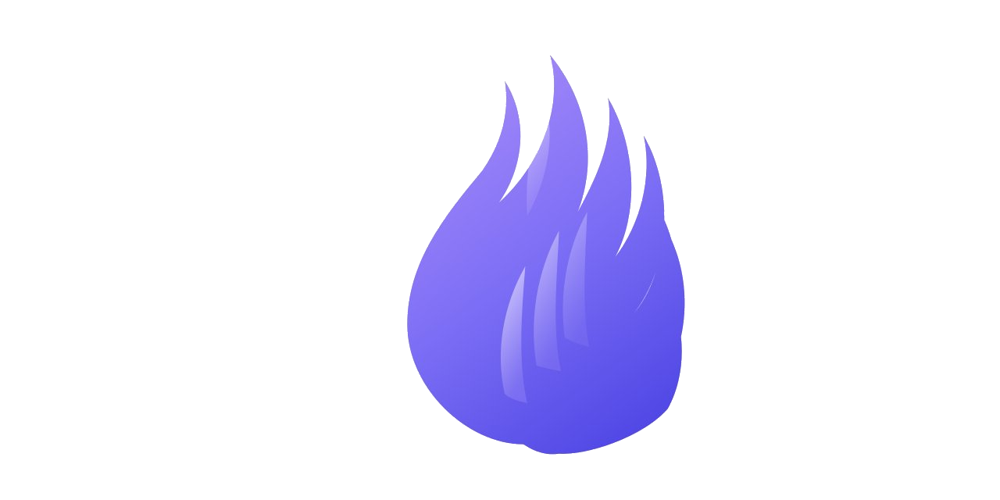
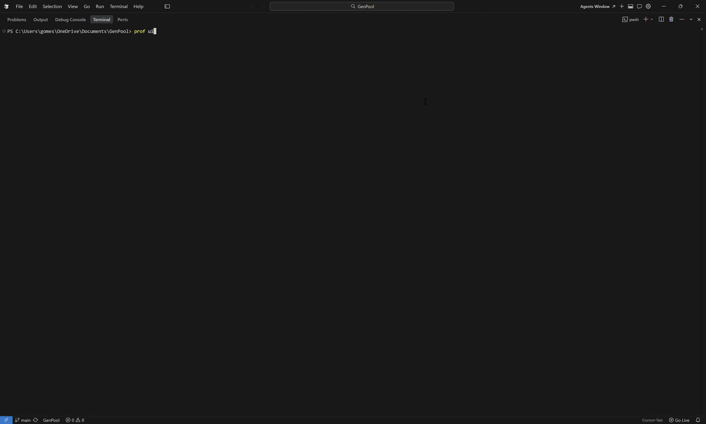

<p align="center">
  
</p>

# Prof

El profiling consume tiempo. Aprender herramientas, ejecutar comandos, buscar la salida. Prof automatiza todo el proceso: un solo comando recopila todo y lo organiza para su análisis.

[](https://godoc.org/github.com/AlexsanderHamir/prof)
[](https://goreportcard.com/badge/github.com/AlexsanderHamir/prof)
[](https://opensource.org/licenses/MIT)
[](https://github.com/AlexsanderHamir/prof/releases)


[Sitio de documentación](https://alexsanderhamir.github.io/prof/)

## Comienza aquí

Desde la raíz de tu módulo (`go.mod`):

```bash
prof ui
```

<p align="center">
  
</p>

## Instalación

```bash
go install github.com/AlexsanderHamir/prof/cmd/prof@latest
```

## Enlaces del repositorio

- [Contribuir](CONTRIBUTING.md) · [Diseño de la base de código](CODEBASE_DESIGN.md) · [Código de conducta](CODE_OF_CONDUCT.md)

## Requisitos

Go 1.24.3+, [Graphviz](https://graphviz.org/) opcional para gráficos de llamadas en PNG, `go.mod` en la raíz del proyecto.

## Licencia

[MIT](LICENSE)
